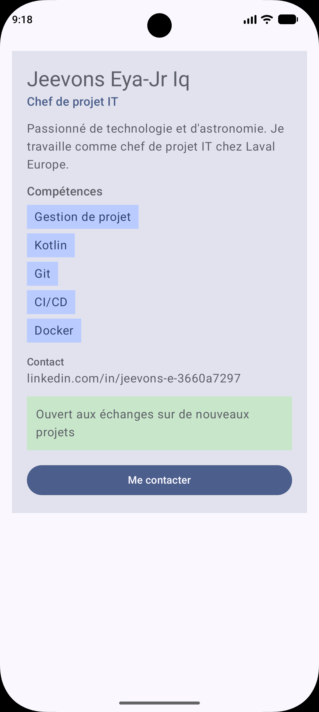

# Profil développeur Compose

## Description

Cette appli Android affiche une fiche "Profil développeur" faite avec Jetpack Compose.
On y voit un nom, un rôle, une petite description, une liste de compétences, un contact et une disponibilité.
Il y a un bouton "Me contacter" et une zone cliquable pour la disponibilité.
Les clics ne changent rien à l'écran pour l'instant, ils appellent juste un callback vide.
Deux previews montrent deux profils différents avec le même code.

## Notions utilisées

- fonctions composables (`@Composable`)
- paramètres
- `Modifier` et chaînage de modifiers
- padding externe / padding interne
- callbacks (`onClick`)
- `Scaffold` et `innerPadding`
- previews (`@Preview`)
- accessibilité de base (`Role.Button`, `contentDescription`)

## Explication

**1. Quels composables avez-vous créés ?**
`EcranProfil`, `FicheProfil`, `EnTeteProfil`, `Competence`, `InfoSecondaire`, `ZoneDisponibilite` et `BoutonAction` (plus les deux previews).

**2. Quel composable représente l'écran principal ?**
`EcranProfil`. C'est lui qui est appelé dans `setContent` depuis `MainActivity`.

**3. Où utilisez-vous un padding externe ?**
Dans `EcranProfil` : il donne `.padding(16.dp)` à `FicheProfil` pour l'écarter des bords de l'écran. C'est le parent qui décide où se place la fiche. Pareil quand `FicheProfil` met un `padding(top = ...)` sur `Competence`, `InfoSecondaire` ou `BoutonAction` pour les espacer entre eux.

**4. Où utilisez-vous un padding interne ?**
Dans `FicheProfil`, la `Column` a un `padding(20.dp)` pour que le texte ne colle pas au bord de la fiche. Dans `Competence` et `ZoneDisponibilite`, le `Text` a aussi un padding à l'intérieur de la `Surface`.

**5. Quel composant reçoit un callback ?**
`BoutonAction` et `ZoneDisponibilite` reçoivent un `onClick`. `FicheProfil` reçoit `onContacterClick` et `onDisponibiliteClick` et les passe plus bas. Les composants signalent juste le clic, c'est `EcranProfil` qui décide quoi faire (pour l'instant rien).

**6. Quelle information d'accessibilité avez-vous ajoutée ?**
`ZoneDisponibilite` est une `Surface` rendue cliquable à la main, donc j'ai ajouté `role = Role.Button` dans `clickable` et une `contentDescription` avec `semantics`. Comme ça un lecteur d'écran annonce que c'est un bouton et dit à quoi il sert. Pour `BoutonAction` je n'en ai pas eu besoin parce que `Button` est déjà reconnu comme un bouton.

**7. Pourquoi vos composants peuvent-ils être considérés comme réutilisables ?**
Ils prennent leurs données en paramètres au lieu d'avoir du texte écrit en dur, et ils acceptent tous un `modifier: Modifier = Modifier`. On peut donc afficher un autre profil sans toucher au code, ce que montrent les deux previews.

## Capture

## Lien du dépôt

https://github.com/Jeevons/profil-dev-compose
